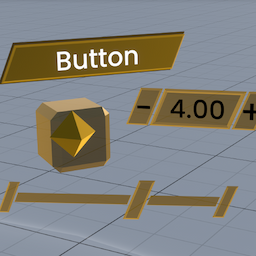

# ClassicLegacyUI

A [Resonite](https://resonite.com/) mod that brings a classic look to Legacy UI you create through Create New.
Customize colors and slants in Bepis Mod Settings.

## Installation

1. Install [BepisLoader](https://thunderstore.io/c/resonite/p/ResoniteModding/BepisLoader/).
2. Install via Thunderstore mod manager or download from [Releases](https://github.com/MarkN2000/ClassicLegacyUI/releases)

## Credits

Inspired by [CustomLegacyUI](https://github.com/HamoCorp/CustomLegacyUI) ([MIT](https://github.com/HamoCorp/CustomLegacyUI/blob/d55152d46b9c89b044120edd9c697cbdc432bc99/LICENSE), Copyright (c) 2024 HamoCorp).

Licensed under the [MIT License](https://github.com/MarkN2000/ClassicLegacyUI/blob/main/LICENSE).
